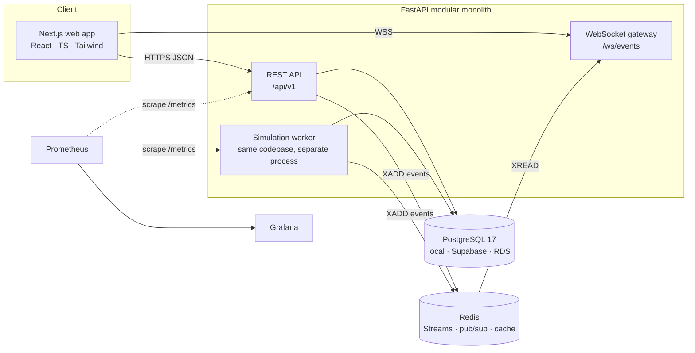
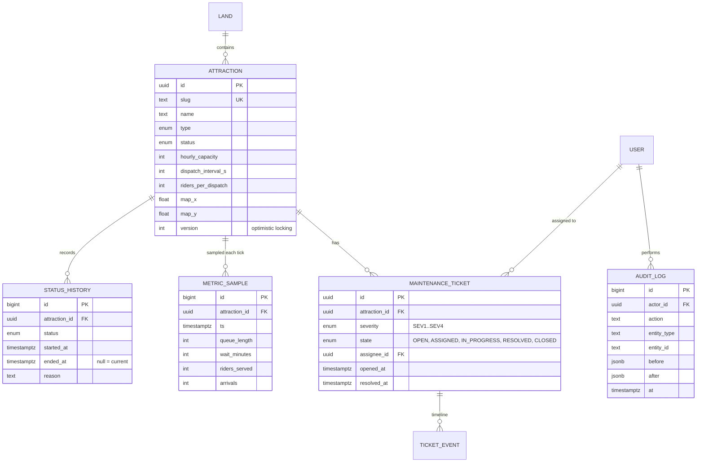

# AFTER HOURS: Architecture

> _The technology behind the magic._ This is a fictional theme-park operations and
> attraction-reliability platform. Every park, attraction, and data point here is invented,
> and all operational data is **simulated**.

Status: **Approved 2026-10-13. Phases 3–8 implemented except Prometheus/Grafana
(see [IMPLEMENTATION_AUDIT.md](IMPLEMENTATION_AUDIT.md)).** Sections marked
_(planned)_ describe intended design that does not exist in code yet. Sections marked
_(implemented)_ match the code.

---

## 1. Fictional domain

**Lanternfall Park** has five lands and roughly 24 attractions:

| Land | Theme | Example attractions |
|---|---|---|
| Tidewater Quay | Harbor / nautical | _Undertow Expedition_, _Lighthouse Leap_ |
| Clockwork Canyon | Steampunk frontier | _Gearspring Runaway_, _Brass Comet_ |
| Aurora Heights | Sky / polar lights | _Borealis Drift_, _Skyward Gondolas_ |
| Emberwood | Enchanted forest at dusk | _Fireflight Hollow_, _Rootbound Rapids_ |
| Starlight Pier | Retro-future boardwalk | _Nebula Spinner_, _Orbit 9_ |

Attraction types: `coaster`, `dark_ride`, `water`, `flat`, `show`, `family`.
Status set: `OPERATING`, `DELAYED`, `DOWN`, `CLOSED`, `REFURB`.

## 2. System context



### Why a modular monolith plus one worker process

- The **API** and the **simulation worker** share one Python package (`afterhours`). The worker
  is a separate *process*, not a separate *service*, because the simulation must have **exactly
  one tick writer**. If ticks ran inside API processes, scaling the API to N replicas would
  produce N ticks per interval.
- Module boundaries live inside the package (`attractions`, `maintenance`, `simulation`,
  `events`, `analytics`, `auth`, `audit`). Each module owns its router, service, repository, and
  schemas. Cross-module calls go through service interfaces, never through another module's
  tables.
- Splitting into microservices is deferred until something measured requires it (ADR-0001).

## 3. Backend module layout _(implemented)_

```
apps/api/src/afterhours/
  core/          config (pydantic-settings), db session, redis client, logging, security
  auth/          login, refresh, JWT, password hashing (argon2), RBAC dependencies
  attractions/   CRUD, status transitions, capacity, status history
  maintenance/   tickets, severity, assignment, lifecycle, resolution
  simulation/    queue model, demand curves, tick loop (worker entrypoint)
  events/        envelope schema, publisher, WS gateway, replay
  analytics/     uptime, MTTR, incident frequency, throughput, utilization
  audit/         append-only audit log written by services
  observability/ Prometheus metrics, request-id middleware, health checks
  main.py        app factory
  worker.py      simulation worker entrypoint
```

Layering inside each module: `router → service → repository → SQLAlchemy models`.
Routers only handle HTTP concerns. Authorization runs as FastAPI dependencies on the routers,
and services repeat ownership checks where a role restriction depends on the data itself (for
example, a technician may update only tickets assigned to them).

## 4. Data model _(implemented, plus `attraction_live` for current queues and `park_samples` for guest flow)_



- **Status history as intervals** (`started_at`/`ended_at`) makes uptime an interval-overlap
  query rather than a reconstruction from point events.
- `metric_sample` is the only high-volume table: about 24 attractions × 1 row per 5-second tick
  ≈ 415k rows/day. It gets a `(attraction_id, ts)` index and a retention job. Native
  partitioning is documented as a scaling step but not built up front.
- `attraction.version` provides optimistic concurrency, so two operators editing the same
  attraction get a `409` instead of a silent overwrite.

## 5. Real-time event engine _(implemented: `events/publisher.py`, `events/gateway.py`, `web/src/lib/realtime/`)_

**Envelope** (shared contract, generated into TypeScript from the OpenAPI/JSON schema):

```json
{ "id": "1739462400000-0", "type": "attraction.status_changed",
  "occurred_at": "…", "entity_id": "…", "payload": { … }, "schema_version": 1 }
```

**Flow.** Services write to Postgres and commit, then `XADD` to the Redis Stream
`ah:events` (capped with `MAXLEN ~ 10000`). Each API process runs one `XREAD BLOCK` loop and
fans events out to its connected sockets.

**Reliability rules**

| Concern | Approach |
|---|---|
| Reconnection | The client reconnects with exponential backoff and jitter, sending `?since=<lastEventId>` |
| Missed events | The server replays from the stream with `XRANGE (lastId +`. If `lastId` has been trimmed away, it sends `resync_required` and the client refetches the REST snapshot |
| Duplicates | Stream IDs are strictly ordered, so the client ignores any event whose `id ≤ lastSeenId` |
| Temporary Redis failure | Writes to Postgres still succeed and the publish failure is logged and counted. Clients detect the gap on reconnect and resync |
| Liveness | Server ping every 15 s; the client treats 2 missed pings as a drop |
| Auth | A short-lived single-use WS ticket is fetched over authenticated REST, because browsers cannot set headers on the WebSocket handshake |

The dual write (DB, then stream) is a known gap: a crash between the two drops an event.
The transactional-outbox alternative is recorded in ADR-0003, along with why snapshot-resync
makes the gap acceptable for this project.

## 6. Wait-time simulation model _(implemented; full write-up in [docs/simulation.md](docs/simulation.md))_

A discrete-time queue model, advancing every `TICK_SECONDS` (default 5 s of wall clock,
optionally time-compressed):

```
λ(t)        = base_demand × popularity × demand_curve(time_of_day) × noise
arrivals    ~ Poisson(λ(t) × Δt)
service     = riders_per_dispatch × floor(Δt / dispatch_interval) × efficiency   (0 if DOWN/CLOSED)
queue'      = max(0, queue + arrivals − service − balks)
wait_min    = queue' / max(service_rate_per_min, ε), rounded to the nearest 5 (as posted signs do)
```

- `demand_curve` is a piecewise curve: morning ramp, midday peak, evening dip, and a
  fireworks-adjacent spike.
- **Balking:** the probability that an arriving guest leaves rises with the posted wait.
- **Downtime:** random breakdowns follow per-attraction MTBF. When a ride is `DOWN`, part of the
  queue abandons each tick.
- **Operating hours:** no arrivals outside park hours, and queues drain at close.
- The RNG is seeded, so tests are deterministic.

Limitations (to be stated in the UI and docs): no guest routing between attractions, no
virtual-queue or skip-the-line systems, no weather, and the parameters are invented rather than
calibrated. Every simulated value carries a `SIMULATED` label in the UI.

## 7. Security & RBAC _(implemented)_

| Permission | Admin | Ops Manager | Technician | Analyst |
|---|:-:|:-:|:-:|:-:|
| View dashboard, map, analytics | ✅ | ✅ | ✅ | ✅ |
| Open/close attraction, change status | ✅ | ✅ | ❌ | ❌ |
| Modify capacity / dispatch config | ✅ | ✅ | ❌ | ❌ |
| Report incident (create ticket) | ✅ | ✅ | ✅ | ❌ |
| Assign ticket | ✅ | ✅ | ❌ | ❌ |
| Update/resolve ticket | ✅ | ✅ | own only | ❌ |
| View audit log | ✅ | ✅ | ❌ | ✅ |
| Manage users, simulation controls | ✅ | ❌ | ❌ | ❌ |

- Permissions are checked on the backend through `require(Permission.X)` dependencies. The
  frontend hides controls only for usability, never as enforcement.
- Passwords are hashed with argon2id. Access JWTs last 15 minutes and are kept in memory.
  Refresh tokens are rotated, stored in an `httpOnly` `SameSite=Strict` cookie, and recorded
  hashed in the database so they can be revoked.
- Inputs are validated by Pydantic v2 models with strict bounds (for example, capacity
  1–5000). CORS uses an allow-list. Failed sign-ons are rate-limited in Redis: 5 per
  (email, client IP) per 15 minutes, then 429 with `Retry-After`. The key is hashed, so no
  emails are stored in Redis.
- Refresh-token reuse within 10 s of rotation returns a retryable `refresh_superseded` error
  instead of revoking the family. This avoids logging users out when two tabs refresh at once.
- Secrets come from environment variables only. `.env.example` is committed and `.env` is
  gitignored.

## 8. Frontend _(implemented)_

- **Next.js 16 (App Router, Cache Components) + strict TypeScript + Tailwind 4.** No component
  library: dialogs use native `<dialog>` (focus trap, Esc, inert background), and controls are plain
  semantic elements.
- **Data:** TanStack Query owns server state. The WebSocket hook applies events directly into
  the Query cache, so there is no second client store.
- **Charts:** Recharts, styled through the `dataviz` skill's palette method.
- **Park map:** a hand-authored SVG. Attractions are focusable buttons with ARIA labels and
  status is shown by icon *and* color (never color alone). Pan and zoom work by wheel, drag,
  pinch, or keyboard.
- **Routes:** `/` command center, `/map`, `/attractions`, `/attractions/[slug]`,
  `/maintenance`, `/analytics`, `/login`. Demo controls live in the header (Administrator).
- **Browser demo build** (`npm run build:pages`, [ADR-0005](docs/adr/0005-browser-only-demo-build.md)):
  a static export for GitHub Pages. `src/lib/demo/` ports the queueing model and implements
  the REST contract and event stream in the page, plugged in through the API client's
  `fetchImpl`. It is labeled as a browser demo on every screen.

## 9. Observability _(implemented except Grafana)_

- **API `/metrics`** (Prometheus, excluded from the OpenAPI schema):
  - `afterhours_http_request_duration_seconds` and `afterhours_http_requests_total`, labeled by
    method and **handler** (the endpoint name). Raw paths would explode label cardinality.
    FastAPI 0.143 nests routers, so the route object holds only its relative path; the
    endpoint name is unique app-wide.
  - `afterhours_ws_connections`.
  - `afterhours_events_published_total{type}` and `afterhours_events_publish_failures_total`.
- **Worker `:9101/metrics`:** `afterhours_sim_tick_duration_seconds` and
  `afterhours_sim_tick_failures_total`.
- **Health:** `/healthz` is liveness. `/readyz` checks readiness of Postgres and Redis and
  returns 503 if either fails.
- **Logs:** structured JSON (structlog) with a `request_id` propagated from `X-Request-ID`.
- **Grafana dashboards:** not built yet. Scrape configs and dashboards-as-code are next.

## 10. Deployment target _(planned; nothing is deployed without approval)_

The only deployed artifact is the static browser demo on GitHub Pages
(`.github/workflows/pages.yml`, free). The full stack is not deployed.

The database is **Supabase-hosted PostgreSQL** for shared dev/demo
([ADR-0004](docs/adr/0004-supabase-as-managed-postgres.md)), and RDS works with the same code.
Docker images for `web`, `api`, and `worker`. Docker Compose for local development. The
AWS-compatible reference deployment is ECS Fargate (web/api/worker) + RDS PostgreSQL +
ElastiCache Redis + ALB (with WebSocket support) + AMP/Grafana. It will be documented in
`DEPLOYMENT.md`, not provisioned.

## 11. Repository structure _(planned)_

```
after-hours-operations/
├── apps/
│   ├── api/                 FastAPI + worker (Python 3.12, uv, Alembic, pytest)
│   │   ├── src/afterhours/
│   │   ├── migrations/
│   │   └── tests/
│   └── web/                 Next.js (TS strict, Tailwind, Vitest, Playwright)
│       ├── src/app/
│       ├── src/components/
│       ├── src/lib/         api client, ws client, generated types
│       └── e2e/
├── infra/
│   ├── docker-compose.yml
│   ├── prometheus/
│   └── grafana/
├── loadtests/k6/
├── docs/
│   ├── adr/                 engineering decision records
│   ├── api.md
│   └── screenshots/
├── .github/workflows/       ci.yml (lint, type, test, build), security.yml (deps scan)
├── README.md  ARCHITECTURE.md  SKILL_USAGE.md
└── DEPLOYMENT.md  TESTING.md  PERFORMANCE.md
```

## 12. Implementation roadmap

| Phase | Deliverable | Exit criteria |
|---|---|---|
| 3 Foundation | Monorepo, API skeleton, DB models + first migration, seed data, auth, web shell, CI | `pytest`, `vitest`, lint, and typecheck pass locally and in CI |
| 4 Command center + attraction mgmt | KPI tiles, attraction grid, status/capacity actions | Operator can change a status and see it persisted and audited |
| 5 Park map | SVG map, filters, detail drawer | Keyboard-navigable; axe check is clean |
| 6 Events + simulation | Worker, queue model, Redis Streams, WS gateway, client replay | Kill/restart test shows no duplicates and resync works |
| 7 Maintenance + RBAC | Ticket lifecycle, assignment, audit log, permission matrix tests | Every permission cell has a test |
| 8 Analytics + observability | Uptime/MTTR endpoints and charts, Prometheus, Grafana | Dashboards render from live scrapes |
| 9 Tests + load | Playwright E2E, k6 REST + WS scenarios | Results recorded in `PERFORMANCE.md` from real runs only |
| 10 Polish + deploy prep | Design audit, motion, Dockerfiles hardening, DEPLOYMENT.md | `security-review` findings addressed |
| 11 Docs + interview prep | All docs finalized, screenshots, case study | Docs cross-checked against code |

## 13. Decision records

See [`docs/adr/`](docs/adr/).
