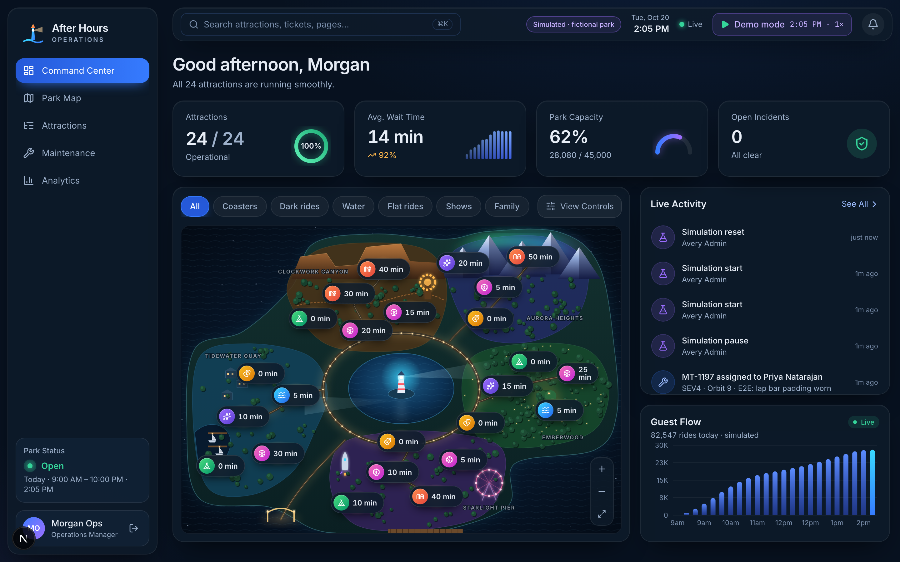
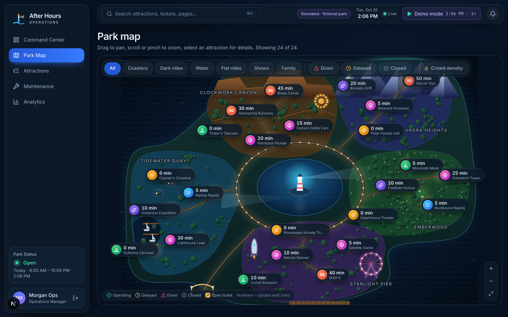
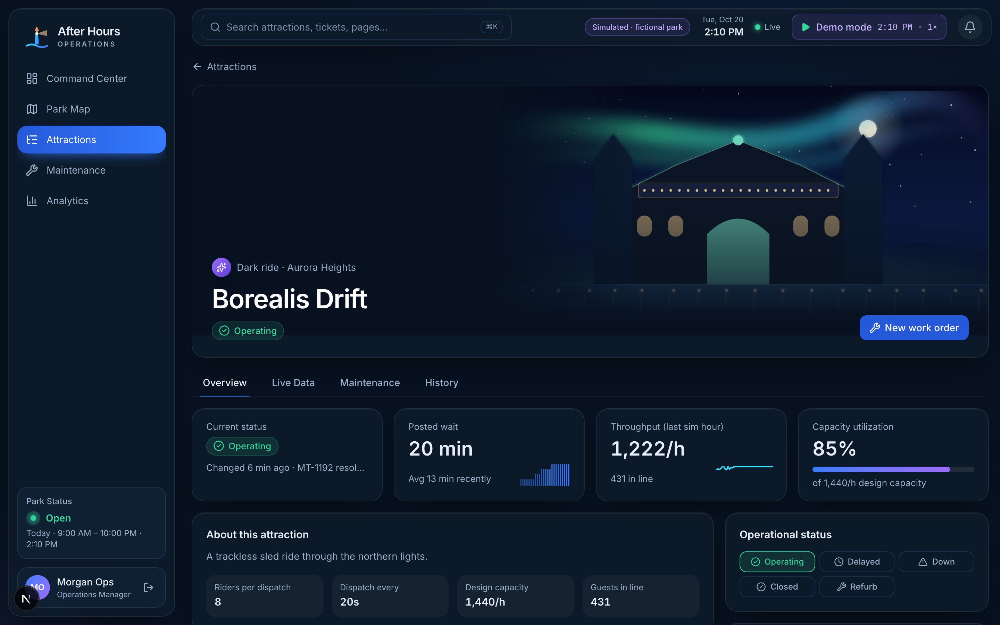
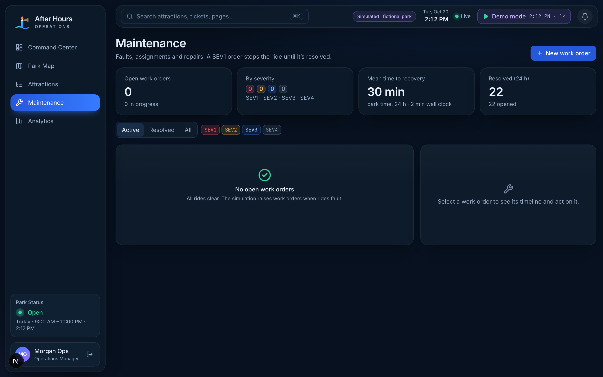
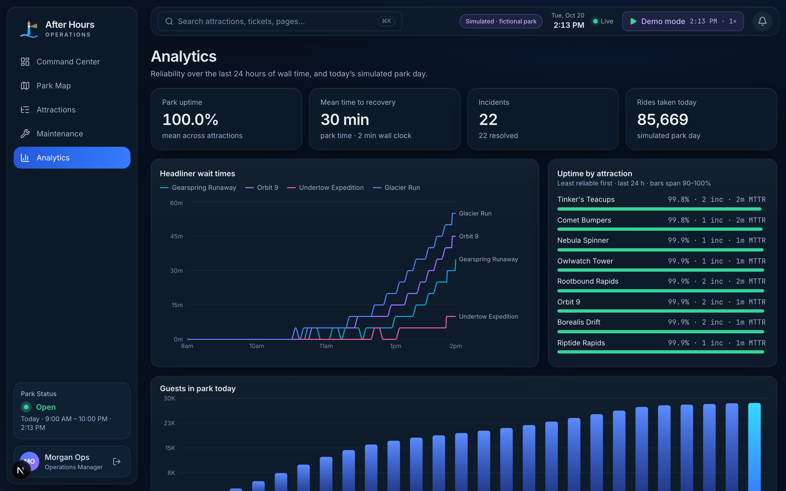
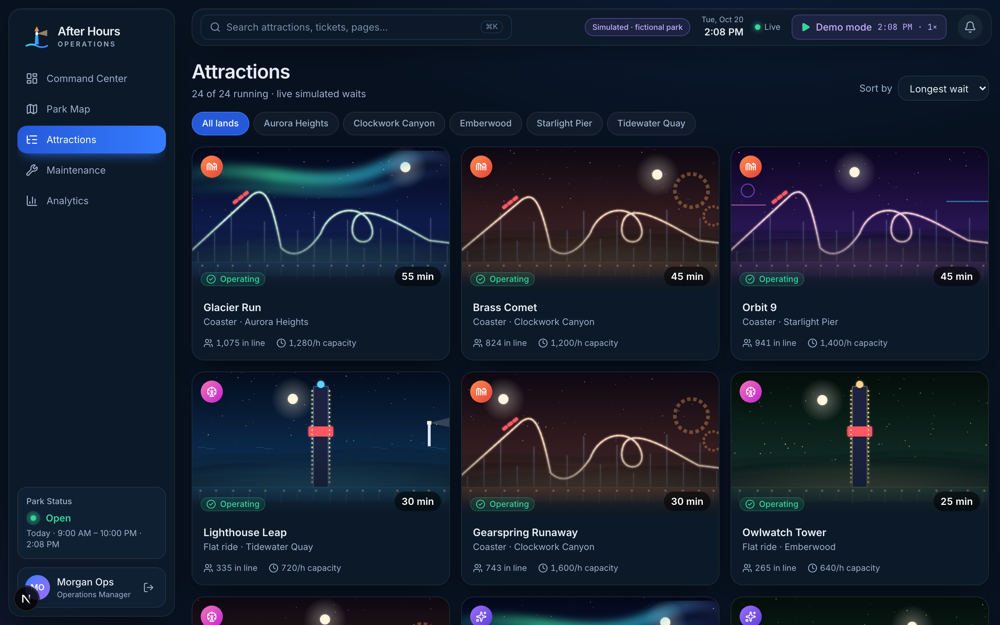
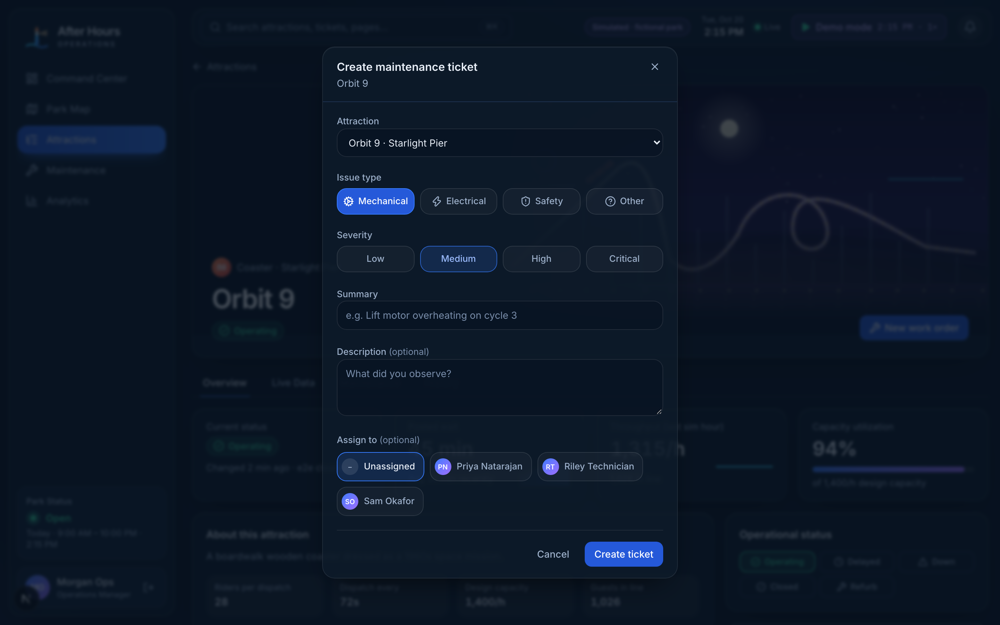

# AFTER HOURS

> **The technology behind the magic.** This is a real-time operations and attraction-reliability
> platform for **Lanternfall Park**, a fully fictional theme park.

All parks, attractions, people, and operational data in this project are **invented**. Wait times,
guest flow, and incidents are **simulated** and are labeled that way throughout the UI.



**[Try the live demo →](https://br3ntw.github.io/after-hours/)** Pick a role and run the park:
stop rides, file work orders and watch the simulation react. The demo is a static build in
which the API and the simulation run **inside your browser**
([ADR-0005](docs/adr/0005-browser-only-demo-build.md)). The full system below runs on FastAPI,
PostgreSQL, Redis and a simulation worker; see [Run it locally](#run-it-locally).

## Status

| Phase | Scope | State |
|---|---|---|
| 1–3 | Environment, architecture, foundation (auth/RBAC, schema, CI) | ✅ |
| 4–8 | Command center, park map, real-time engine and simulation, maintenance, analytics | ✅ Built in the visual and functional overhaul ([audit and results](IMPLEMENTATION_AUDIT.md)) |
| 9 | Automated E2E (Playwright) and k6 load tests | ✅ [TESTING.md](TESTING.md) · [PERFORMANCE.md](PERFORMANCE.md) |
| 8b | Prometheus metrics (API `/metrics`, worker `:9101`), login rate limiting | ✅ (Grafana dashboards not built) |
| 10–11 | Grafana, deployment docs, case study | Planned |

## What it does

- **A live park.** A simulation worker runs a documented queueing model
  ([docs/simulation.md](docs/simulation.md)): guests arrive, lines grow, rides break down, and
  technicians fix them. Every value is labeled *Simulated*.
- **Real-time everywhere.** Redis Streams feed a WebSocket. Clients resume from their last
  event id after a drop, ignore duplicates, and resync when they've been away too long.
- **Operators act, and the park reacts.** Close a ride and its map marker, the live feed, and
  the KPIs update within a second. A SEV1 ticket stops the ride; resolving it reopens the ride.
- **Four screens.** Command Center, a pan/zoom Park Map, Attraction Details (charts, history,
  capacity configuration), and Maintenance (assignment, lifecycle, timeline). Analytics adds
  uptime, MTTR, and wait trends.
- **Demo Mode.** Administrators can start, pause, reset, change speed, or trigger a downtime
  drill.
- **RBAC enforced by the API.** Four roles. The sign-in page offers one-click demo roles
  (enabled only outside production).

| | |
|---|---|
|  |  |
|  |  |
|  |  |

## Run it locally

Prerequisites: [uv](https://docs.astral.sh/uv/), Node 24+, PostgreSQL 17, and Redis (macOS:
`brew install uv postgresql@17 redis` and start both services).

**One-time setup:**

```bash
createdb afterhours_dev && createdb afterhours_test
cp apps/api/.env.example apps/api/.env      # then set AH_JWT_SECRET (instructions inside)
(cd apps/api && uv sync) && (cd apps/web && npm ci)
```

**Every time:** this migrates, seeds, and starts the API, the simulation worker, and the web
app.

```bash
npm run dev                 # from the repo root: API + worker + web (runs ./scripts/dev.sh)
```

Open http://localhost:3000 and pick a role. **Operations Manager** is the best first tour.
**Administrator** adds the Demo Mode controls.

To use **Supabase** instead of local Postgres, see the comments in `apps/api/.env.example`
and [ADR-0004](docs/adr/0004-supabase-as-managed-postgres.md).

## Documentation

[ARCHITECTURE.md](ARCHITECTURE.md) · [IMPLEMENTATION_AUDIT.md](IMPLEMENTATION_AUDIT.md) · [Simulation model](docs/simulation.md) · [TESTING.md](TESTING.md) ·
[SKILL_USAGE.md](SKILL_USAGE.md) · [API contract](docs/openapi.json) · [Decision records](docs/adr/)

_DEPLOYMENT.md, PERFORMANCE.md, screenshots, and the case study will be written in the phases
that produce their content (10 and 11). PERFORMANCE.md will contain measured results only._
